

# 🛍️ SleyMart: Shopify Store Showcase

**A fashion dropshipping store I designed and built on Shopify for SleyMart, selling shoes and clothing for women and men to customers in the USA.**

<picture></picture>
<picture></picture>

<picture></picture>
<picture></picture>
<picture></picture>
<picture></picture>

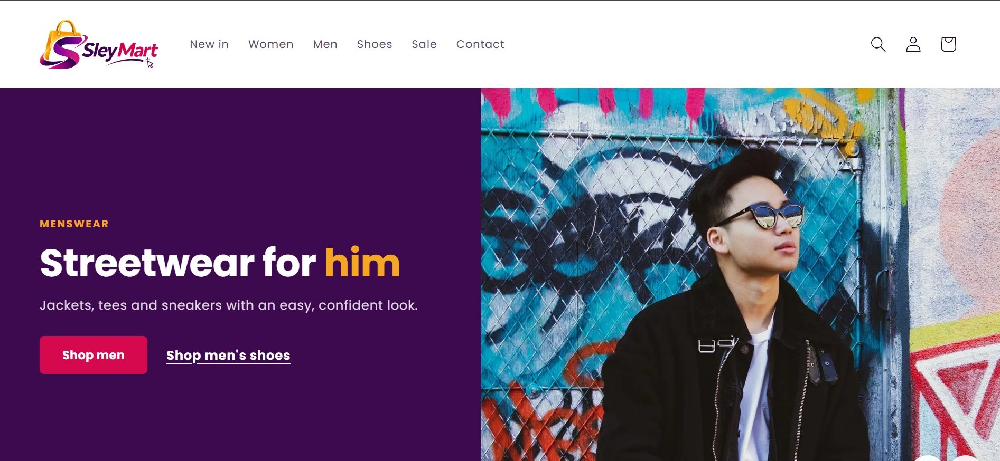

---

## 📌 About the project

SleyMart is an online fashion store for the US market. It sells shoes and clothing for women and men through a **dropshipping** model: products come from a supplier and ship directly to the customer, so the store holds no stock.

The client needed a complete store, ready to sell, in a short time. The store needed to:

- look like a real fashion brand, built around the SleyMart logo and its purple, crimson and gold colours
- make it easy to shop by category: women's clothing, men's clothing, women's shoes, men's shoes, new arrivals and sale
- be connected to a dropshipping supplier, with products imported, priced and organised
- build trust with clear shipping, returns and secure checkout information
- work well on phones, where most fashion shoppers browse

I was responsible for the **whole build**: theme design and development, banners and imagery, product import and organisation, collections, menus, pages, policies and store settings.

---

## ✨ Features

| Area | What I built |
|---|---|
| 🎨 **Brand & design** | A custom theme in SleyMart's colours (deep purple, crimson and gold) with bold, modern type |
| 📣 **Announcement ticker** | A scrolling bar with free US shipping over $50, new styles every week, 30-day returns and secure checkout |
| 🖼️ **Hero slideshow** | Separate slides for womenswear, menswear and shoes, each with its own colours and call-to-action buttons |
| 🗂️ **Shop by category** | Image tiles for women's clothing, men's clothing, women's shoes, men's shoes, new arrivals and sale |
| 🛒 **Products** | **99 products** imported from **CJdropshipping**, priced in USD, with size and colour options |
| 📚 **Collections** | **7 automated collections** that fill themselves by product type and tags (Women, Men, Shoes, New Arrivals, Best Sellers, Sale) |
| 🏷️ **Homepage sections** | New arrivals, best sellers, men's picks and women's shoes rows, promo banners and a "Matching looks for two" feature |
| ✅ **Trust bar** | Free US shipping, easy returns, secure checkout (cards, Apple Pay, PayPal) and customer help |
| ✉️ **Newsletter** | A sign-up offering 10% off the first order, linked to a welcome discount code |
| 📄 **Pages & policies** | About, Contact, Size guide and Shipping info pages, plus refund, privacy, terms and shipping policies |
| 🧭 **Navigation** | Menus for New in, Women, Men, Shoes, Sale and Contact |
| 📱 **Responsive** | Layouts tuned for phones, tablets and desktop |

---

## 🖼️ Screenshots

### Home: menswear slide

### Home: womenswear slide, ticker and trust bar
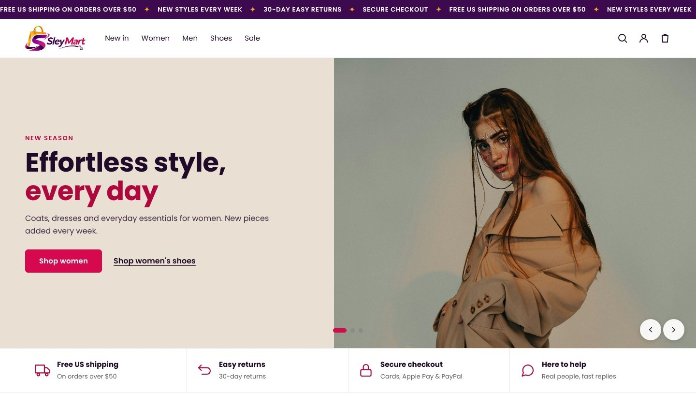

### Shop by category
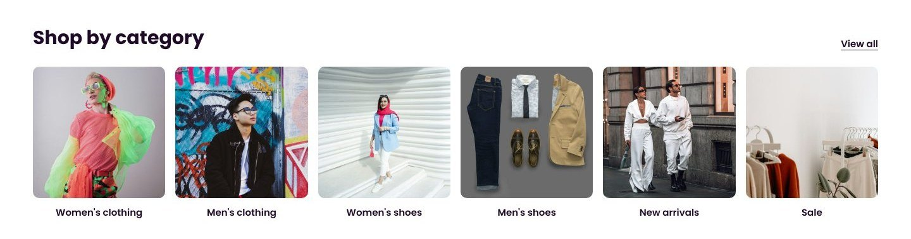

### Women's collection
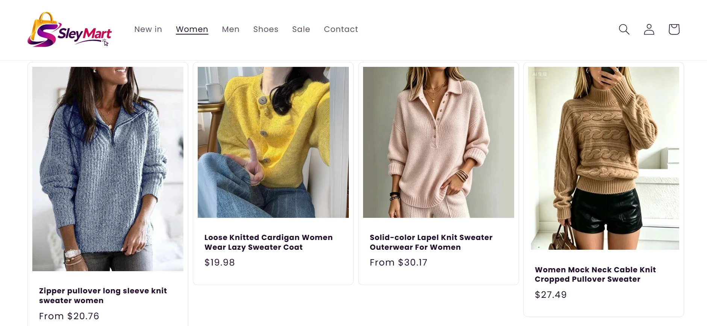

### New arrivals
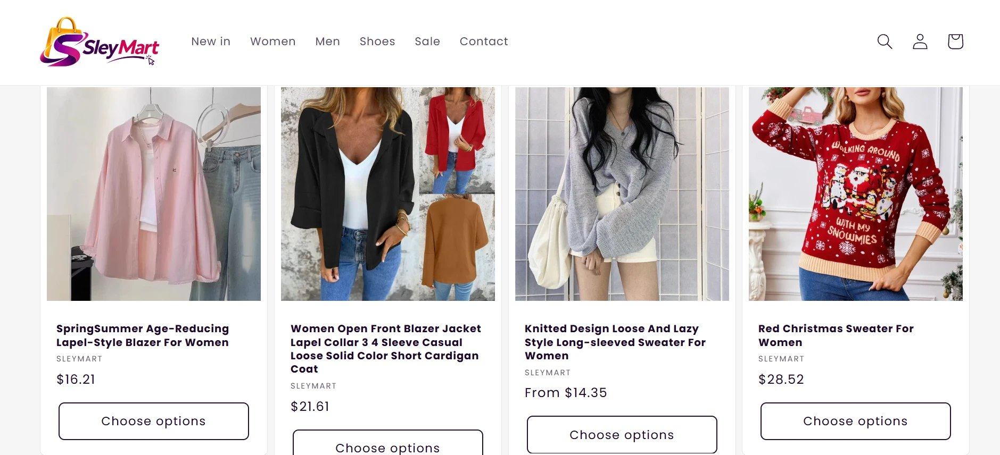

### Sweaters & sneakers
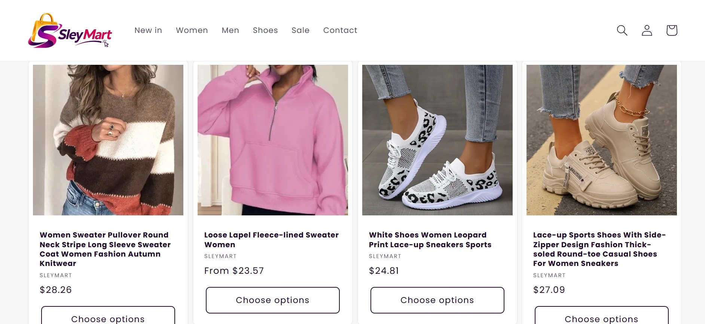

### Shoes collection
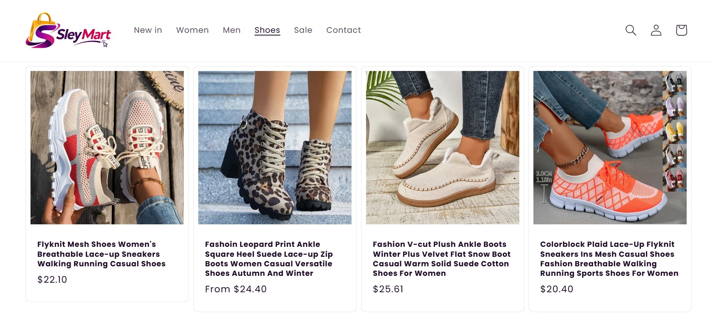

### Promo banners
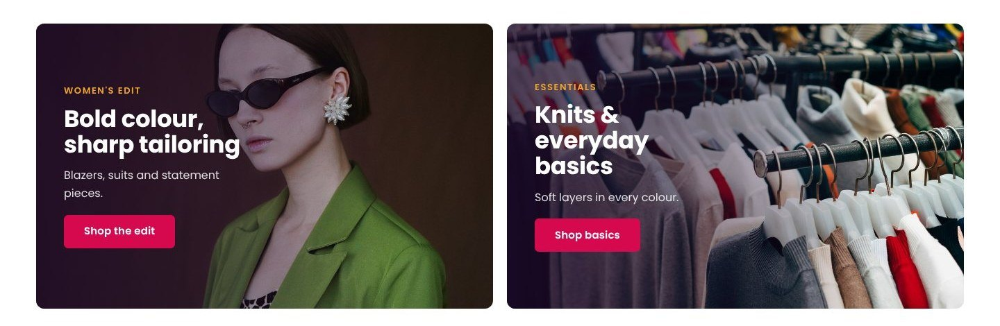

### Matching looks for two
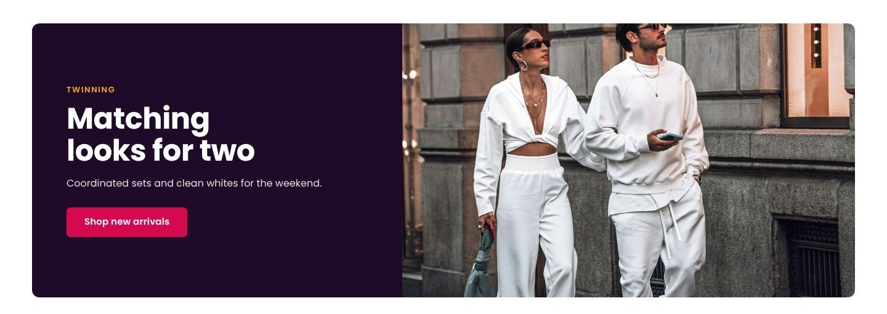

### Mobile
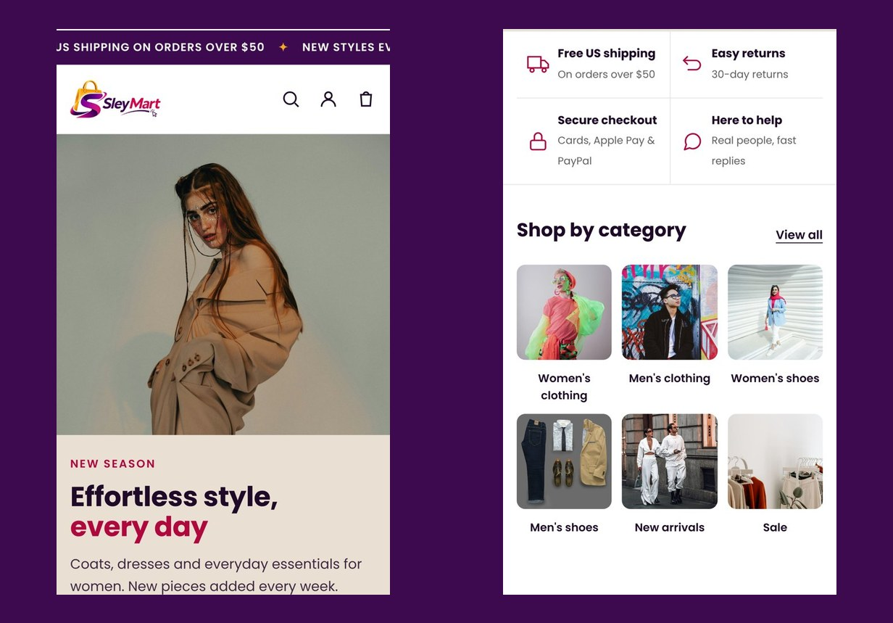

### Newsletter & footer
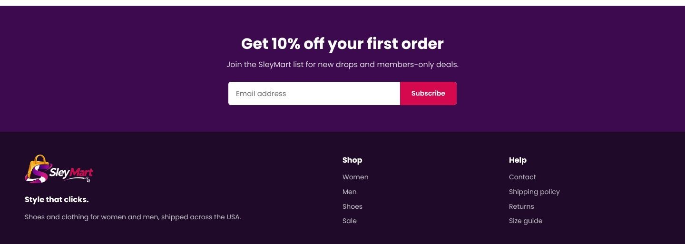

---

## 🛠️ Tech stack

- **Platform:** Shopify Online Store 2.0, with a custom Dawn-based theme
- **Theme development:** Liquid, JSON templates, sections and blocks, CSS and JavaScript
- **Dropshipping:** CJdropshipping app for product import and order fulfilment
- **Store setup:** automated collections, menus, US market and USD currency, shipping rules, discount codes and policies
- **Tooling:** Python (Pillow) scripts to build the banner and category images, Shopify theme packaging

---

## 🧭 My process

1. **Brief:** gathered the niche, target market (USA), currency (USD) and the client's logo.
2. **Design:** built the theme around the logo's colours, with a homepage made for browsing fashion.
3. **Imagery:** prepared banner and category images from licensed stock photos, checked for any brand logos.
4. **Products:** connected CJdropshipping, imported 99 products and organised them by type and tags so the collections fill automatically.
5. **Store setup:** menus, pages, policies, shipping, the welcome discount and US market settings.
6. **QA and handover:** checked every page, link and collection on desktop and mobile, then handed the store over for the client to choose a plan and connect payments.

---

## ✅ Status

**Delivered.** The store is built and handed over to the client, who will choose a Shopify plan and connect payments before launch.

---

## 🔒 Why there's no source code here

> [!IMPORTANT]
> **This is a showcase repository. It contains only screenshots and this write-up.**
>
> SleyMart is a **real client project**. The client owns the store and its theme, so the source code is kept in a **private repository**. It contains the client's branding, store configuration and supplier setup.
>
> Making that repository public would expose the client's data, so I keep it private. This repo explains what I built and how.

---

## 👨‍💻 Author

**Jamshaid Khan Niazi**, web developer

- 🌐 Portfolio: [jamshaidkhanniazi5965-ship-it.github.io](https://jamshaidkhanniazi5965-ship-it.github.io)
- 💼 GitHub: [@jamshaidkhanniazi5965-ship-it](https://github.com/jamshaidkhanniazi5965-ship-it)

---

© SleyMart. The brand, logo, product photos and content belong to the client and its suppliers, and are shown here for portfolio purposes only. The source code is not included.

